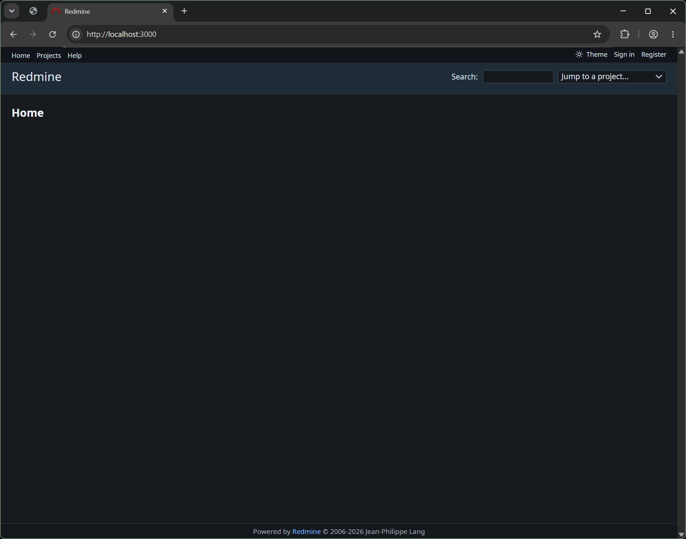
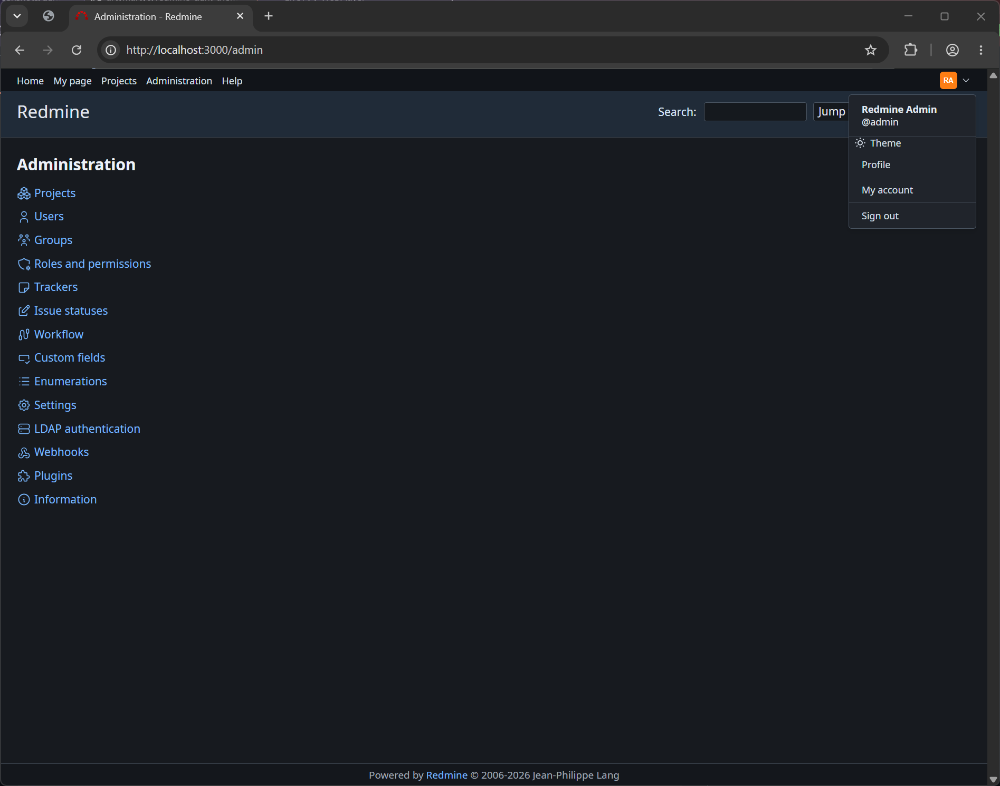
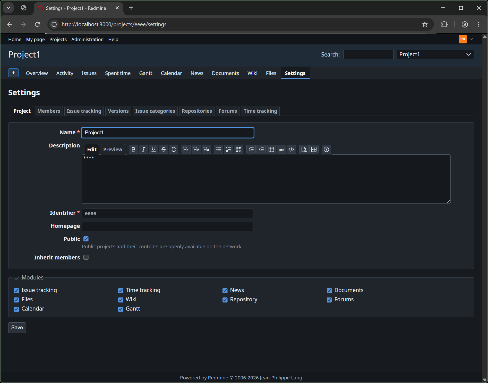

# Redmine Dark Theme Switcher

A simple plugin that adds a dark mode to Redmine and makes the interface easier to use in low-light conditions.

## Dark mode preview

## What it does

- Adds a quick theme switcher in the account menu
- Switches Redmine to a dark color palette
- Remembers the selected theme in the browser
- Uses the system dark mode preference by default when available

## Main features

- Light and dark mode toggle
- Clean dark interface for the main Redmine pages
- Better readability for tables, forms, wiki pages, and code blocks
- No server-side configuration required
- An admin page checks whether a newer version is available on GitHub

## Installation

1. Copy the plugin folder into your Redmine `plugins/` directory.
2. Restart Redmine.
3. Log in and use the theme switcher in the account menu.
4. Administrators can check for updates under **Administration → Theme Switcher Updates**.

## Versioning

Releases are tagged `vX.Y.Z` in Git (e.g. `v1.1.0`, `v1.0.0`), while the plugin version declared in `init.rb` stays `X.Y.Z` without the prefix. The admin update check reads GitHub tags and tolerates the `v` prefix, so keep both values in sync in the same commit.

## Notes

- The plugin is designed for Redmine 6+
- Theme settings are saved in the browser, not on the server
- It is a visual enhancement focused on usability and readability
- The plugin homepage is shown on the Redmine plugins page; version checks use GitHub tags and require an internet connection.
