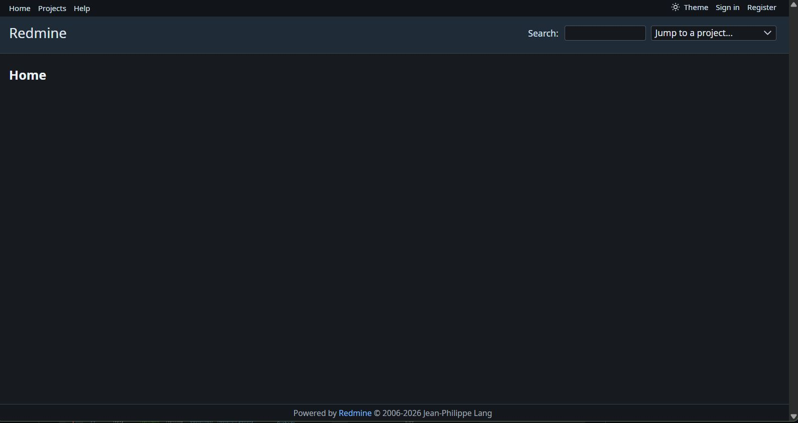
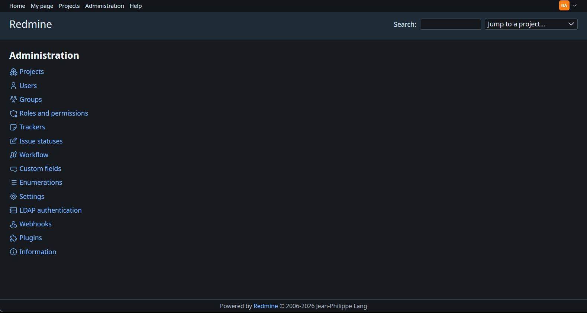
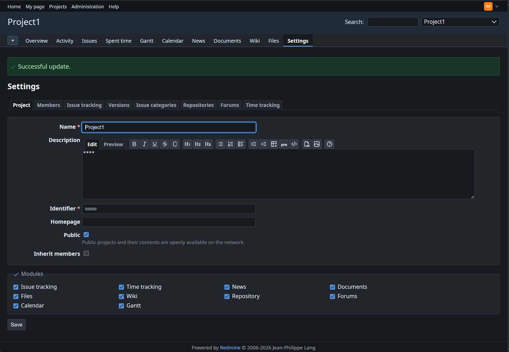

# Redmine Dark Theme Switcher

A simple plugin that adds a dark mode to Redmine and makes the interface easier to use in low-light conditions.

## Dark mode preview

## What it does

- Adds a quick theme switcher in the account menu
- Switches Redmine to a dark color palette
- Remembers the selected theme in the browser
- Uses the system dark mode preference by default when available

## Main features

- Light and dark mode toggle
- Clean dark interface for the main Redmine pages
- Better readability for tables, forms, wiki pages, and code blocks
- No server-side configuration required

## Installation

1. Copy the plugin folder into your Redmine `plugins/` directory.
2. Restart Redmine.
3. Log in and use the theme switcher in the account menu.

## Notes

- The plugin is designed for Redmine 6+
- Theme settings are saved in the browser, not on the server
- It is a visual enhancement focused on usability and readability
